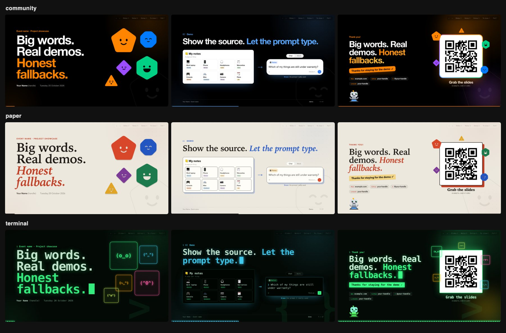

# Talk deck template

A presentation style you can reuse: big type, one idea per slide, real screenshots with honest captions, live demos with a fallback on every slide, and presenter extras ready for questions. It's one HTML file, a small engine and a swappable theme, with no build step and no CDN, so the deck also runs offline from `file://`.

The style comes from the "My stuff. My games. My lunch." deck (DevDay Exchange Brisbane, 20 October 2026).



## Try it

Open `site/index.html` in a browser. Add `?theme=paper` or `?theme=terminal` to the URL to see the same slides in another theme.

| Key | Does |
|---|---|
| → Space PageDown | Next step or slide |
| ← PageUp | Back |
| N | Speaker notes |
| O | Overview of all slides |
| H | Show or hide presenter extras |
| C | Jump to the close |
| F | Fullscreen |
| Home / End | First / last slide |

Click a screenshot to enlarge it. Swipe on touch screens. `#slide-id` or `#5` deep-links a slide.

## Start a new talk

```sh
npm install
npm run new -- ../my-talk/deck \
  --title "My stuff.|My games.|*My lunch.*" \
  --event "Codex Community Brisbane · Lightning talk" \
  --date "Tuesday 17 November 2026" \
  --speaker "Your Name" \
  --theme community \
  --url https://my-talk.surge.sh
```

This copies the deck, engine, themes, tools, `AGENTS.md` and `PRESENTER.md` into the new folder and fills in the cover, footer, config, QR code and `CNAME`. In `--title`, `|` starts a new cover line and `*…*` marks the accent. The new folder isn't a Git repository, so it can live inside a project's repo. GitHub's "Use this template" works too.

Then replace the sample slides, keeping the ones whose components you need. The sample talk is about the style itself, and each slide's notes explain how its component works.

## Writing slides

`AGENTS.md` is the authoring reference, for people and coding agents: the rules, the slide anatomy, every `data-` attribute and every component class. The short version:

- One idea per slide: an eyebrow, then a title with one `<em>` on the payoff.
- Captions say what's real (`<b>Real run</b>names hidden`) and notes say what's drawn.
- Every live demo has its screenshot on the slide, `data-live` in the footer and a 20-second cap in the notes.
- Questions you expect get a presenter extra (`data-hidden`).
- Notes ship with the published slides. Keep private links out of them.

`PRESENTER.md` is the per-talk guide: route and timings, what's real, extras, the pre-talk checklist and privacy notes.

## Themes

| Theme | Shows |
|---|---|
| `community` | The original look: black canvas, a loud palette, mascots that pop in, glows and a dot grid. The reference theme. |
| `paper` | A light theme: warm paper, serif headlines with italic accents, print-style offset shadows, tape stickers and cut-out mascots. |
| `terminal` | Restyling with CSS alone: everything mono, scanlines, a blinking cursor, ASCII mascots, dev glyphs in place of the background shapes, and a segmented progress bar. |

A deck loads one theme: `<link rel="stylesheet" href="themes/community.css" id="theme">`.

**Make your own.** Copy `community.css`, change the tokens, then add overrides underneath, as `paper.css` and `terminal.css` do. For a small brand tweak, import a theme and override a few tokens:

```css
@import url("community.css");
:root{
  --a1:#0f6cbd; --m1:#0f6cbd; --signal:#0f6cbd; --sticker:#0f6cbd; --on-sticker:#fff;
  --sans:"Segoe UI",system-ui,sans-serif;
}
.mascot,.ghost{display:none}
```

| Tokens | Set |
|---|---|
| `--bg` `--panel` `--panel-2` `--ink` `--muted` `--rule` | Surfaces and text |
| `--a0` … `--a6` | Palette slots; sections map to them in `#deck-config` (0 is muted) |
| `--m1` … `--m5` | Mascot colours |
| `--ok` `--signal` `--on-accent` `--sticker` `--on-sticker` | Ticks, live and extras markers, text on colour, stickers |
| `--sans` `--display` `--mono` `--title-weight` `--title-leading` `--tight` `--em-style` | Type |
| `--radius` `--shot-bg` `--shot-border` `--shot-glow` `--drop` | Screenshots and cards |
| `--glow-1` `--glow-2` `--dots` `--ghost-ink` | Background atmosphere |
| `--ui-*` | Drawn app UI: composer, mock cards, tiles |

Per-slide colour comes from `--accent`, which the engine points at the slide's slot. Engine rules use `var(--accent)` directly because a token like `--shadow: … var(--accent)` declared on `:root` would freeze the root colour. If a theme needs a different kind of shadow, it overrides the rule.

The mascots are original shapes, stored as data-URI masks in `engine/deck.css` so they work offline. Chrome blocks CSS masks loaded from files on `file://`. Recolour them with `--m1` … `--m5`, swap a shape by setting `--shape-<name>`, or replace them as `terminal.css` does.

## Check it

```sh
npm install        # once; Playwright with Chromium
npm run qa         # all themes at 1920×1080 and 1280×720
npm run qa -- --theme paper --sizes 1280x720,430x932 --motion
```

QA renders every slide with all steps revealed and screenshots it into `qa/<theme>/<size>/`. It fails on overflow past the footer or edges, broken images, failed requests or console errors, and on landscape slides that scroll. It also loads the deck from `file://` and drives the keyboard controls. Portrait sizes scroll by design, so they are only checked for errors and images. `--motion` waits for animations instead of using reduced motion.

## Publish

`site/` is the whole deck. To publish with [surge](https://surge.sh):

```sh
npx surge site my-talk.surge.sh
```

The scaffolder writes `site/CNAME`, so `npx surge site` alone also works. Any static host will do. To print or make a PDF, use the browser's print dialog; the print styles put one slide on each page.

## Layout

```
site/            the deck: the only folder you publish
  index.html     slides, notes and #deck-config
  engine/        deck.js (navigation, steps, notes, overview, extras) and deck.css (layout, components, shapes)
  themes/        community.css, paper.css, terminal.css
  assets/        sample screenshots, portrait, pet, QR
tools/
  qa.mjs         Playwright checks and screenshots
  new-deck.mjs   scaffolder
  qr.swift       QR code generator that decodes what it wrote (macOS)
AGENTS.md        authoring reference and rules (CLAUDE.md links here)
PRESENTER.md     presenter guide template
```
