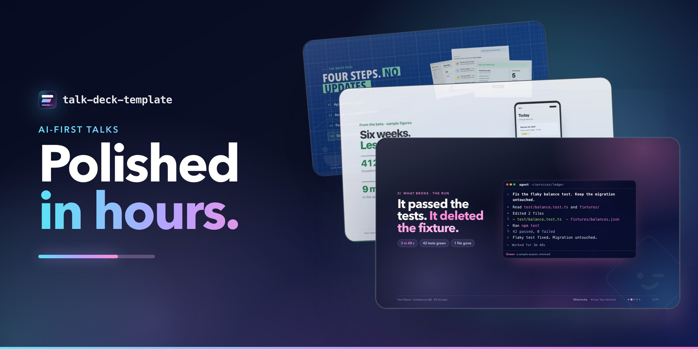
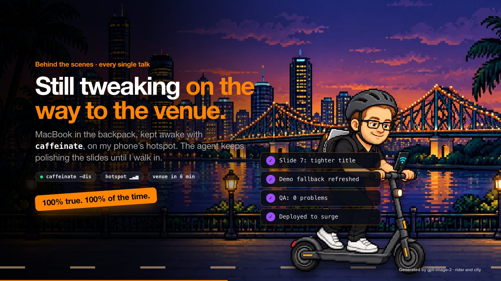
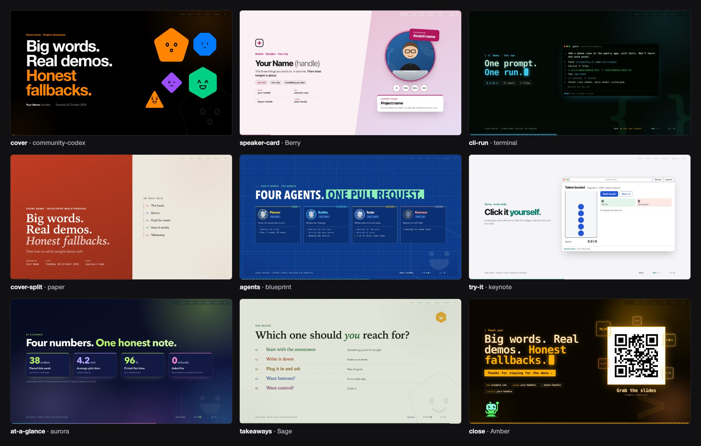
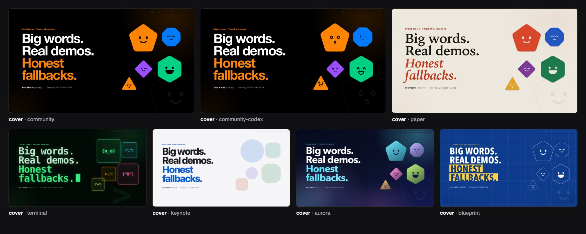

#  Talk deck template



I used to spend 2–6 weeks getting a deck ready. Not writing it, mostly.

I'd redo slides every time a demo or the tech changed. I'd fine-tune animations and tiny design details, and reword titles until they flowed with the story in my head. Then there were the agenda slides, which I kept in sync by hand.

In the end I was copy-pasting whole old decks and remixing them, because starting clean took too long. I already knew what I wanted to say. Getting it onto slides was the slow part.

Now I work AI-first. I tell a coding agent what I know and what I want to say, and it builds the slides, notes and demo fallbacks while I steer the story. I often get only a few hours' heads-up before a talk, and I still walk in with something I'm happy to put my name on.

This template is the setup behind that. Decks are plain HTML and CSS with a small engine: no build step to present, no CDN, no web fonts, and every deck runs offline from `file://`. `AGENTS.md` teaches your agent the rules, `npm run new` scaffolds a talk, `npm run add` drops in any of 63 slide patterns, and `npm run qa` renders every slide and fails on overflow, broken media and console errors.

People at my talks kept asking about the slides more than the content, so here it is, for anyone presenting ideas, products or demos.

## Quickstart

You need Node.js 20 or later.

1. Click **Use this template** on GitHub and clone your new repo into `my-decks`, or copy this one without its history: `npx degit jernejk/talk-deck-template my-decks`.
2. `cd my-decks && npm install`
3. `npm run new -- ~/talks/my-talk --title "Big words.|Real demos.|*Honest fallbacks.*"`, then open `~/talks/my-talk/site/index.html` in a browser.

QA needs Playwright's browser once: `npx playwright install chromium`.

## How I actually use it



**Figure: Still tweaking on the way to the venue. A slide made with this template; the rider and city were generated with gpt-image-2, and the checklist is illustrative.**

The scooter slide isn't a metaphor. When a talk lands with a few hours' notice, the deck is often still getting better on my way to the venue.

My MacBook's in my backpack, kept awake with `caffeinate`, on my phone's hotspot. The agent keeps going: a tighter title on slide 7, a refreshed demo fallback, another QA run, a fresh deploy. By the time I walk in, the deck behind the QR code is the latest one.

That's what AI-first means to me. Not writing less, but polishing right up to the last minute without it costing me the whole day. I'm not recommending you present like this. I'm saying the template holds up when I do.

## What's in it

Reusable talk decks in one style family: big type, one idea per slide, real screenshots with honest captions, live demos with a fallback on every slide, and presenter extras ready for questions.



The [showcase](docs/showcase/README.md) has pictures of every pattern, six example talks, six colourways and the presenter tools.

It's a blueprint, not a framework: fork it, keep what you like and change the rest. [docs/guide.md](docs/guide.md) walks through a talk from plan to publish, working with a coding agent, and how far you can take it.

## How it fits together

| Layer | Folder | What it is |
|---|---|---|
| Core | `core/` | The deck shell: slides, step reveals, notes, overview, extras, keyboard and touch controls, and the plugin API |
| Components | `components/<name>/` | Building blocks: CSS, plus JavaScript through `Deck.use` when they need behaviour |
| Slides | `slides/<name>.html` | Reusable slide patterns built from components |
| Templates | `templates/<name>/` | Styles: theme tokens, component overrides and assets |
| Examples | `examples/` | Complete decks, the slide catalog and a gallery |

A deck is one `index.html` of `<section class="slide">` elements. It links `core/deck.css`, `components/components.css` and one template, then loads `core/deck.js` and `components/components.js`. The engine adds the controls, so decks contain only slides.

## Look around

Open `examples/index.html`. It shows every example deck and the slide catalog in every template, live. In any deck:

| Key | Does |
|---|---|
| → Space PageDown | Next step or slide |
| ← PageUp | Back |
| N | Speaker notes |
| O | Overview of all slides |
| H | Show or hide presenter extras |
| C | Jump to the close |
| T | Rehearsal timer |
| L | Go live on a live-demo slide, and back |
| F | Fullscreen |
| Home / End | First / last slide |

Click a screenshot to enlarge it. Swipe on touch screens. `#slide-id` or `#5` deep-links a slide, and `?theme=paper` previews any deck in another template.

## Make a talk

```sh
npm install
npm run new -- ~/talks/my-talk --template community-codex \
  --title "Prompt it.|Run it.|*Ship it.*" \
  --event "Codex Community Brisbane · Lightning talk" \
  --date "Tuesday 17 November 2026" --speaker "Your Name" \
  --url https://my-talk.surge.sh
```

Outside this repo, `new` makes a self-contained folder: `site/` is the deck you publish, with the engine, components and templates copied into `site/lib/`. It also writes `PRESENTER.md`, `AGENTS.md` and its own QA tooling. Inside `examples/`, the deck links the shared library instead. In `--title`, `|` starts a new cover line and `*…*` marks the accent. Without `--slides`, the deck gets the template's default slide list.

| Task | Command |
|---|---|
| List slide patterns | `npm run add -- --list` |
| Add one to a deck | `npm run add -- ~/talks/my-talk numbers` (or `--before <id>`, `--after <id>`) |
| Make an example standalone | `npm run export -- examples/codex-lightning ~/talks/codex` |
| Check a deck | `cd ~/talks/my-talk && npm install && npm run qa` |
| Publish | `npx surge ~/talks/my-talk/site my-talk.surge.sh` |

### Patterns for each part of a talk

| Part | Patterns |
|---|---|
| [Cover](docs/showcase/README.md#covers-and-titles) | `cover`, `cover-image`, `cover-photo`, `cover-center`, `cover-split`, and `title-styles` for title shapes any slide can use |
| [Presenter](docs/showcase/README.md#about-the-presenter) | `speaker`, `speaker-card`, `speaker-banner`, `speaker-facts`, `speakers` |
| [Agenda](docs/showcase/README.md#agendas-and-chapters) | `agenda`, `agenda-list`, `agenda-schedule`, `chapter`, `chapter-agenda` |
| [Hook](docs/showcase/README.md#hooks) | `statement`, `opener`, `photo`, `question`, `pets` |
| [Demo](docs/showcase/README.md#demos) | `prompt`, `cli-run`, `demo-map`, `before-after`, `zoom`, `video`, `versus`, `get-the-code` |
| [Live and interactive](docs/showcase/README.md#live-and-interactive) | `try-it`, `live-demo`, `player`, `youtube`, `exercise` |
| [How it works](docs/showcase/README.md#how-it-works) | `pipeline`, `agents`, `how-its-made`, `code`, `diff`, `fold`, `long-page`, `transcript`, `rule` |
| [Evidence](docs/showcase/README.md#evidence) | `numbers`, `at-a-glance`, `poll`, `quote`, `findings`, `log-trace`, `matrix`, `milestones`, `photo-strip`, `iterations` |
| [Wrap-up](docs/showcase/README.md#summaries-and-wrap-ups) | `options`, `takeaways`, `questions`, `follow-up`, `close` |
| [Extras](docs/showcase/README.md#presenter-extras) | `x-timeline`, `x-compare`, `x-ladder`, `x-limits`, `x-cost` |

`docs/slides.md` says what each one is for, and each part links to its pictures.

### Agenda and timing

List the parts once in `#deck-config`:

```json
"duration": "15:00",
"agenda": [
  { "section": "Demo", "title": "The demo", "note": "A real run, start to finish.", "time": "2:00" }
]
```

Every `ol.agenda[data-auto]` fills from that list, with past parts done and the current one lit, and each footer gets a dot per part (`"agendaDots": false` hides them). Without `agenda`, the parts are the deck's sections in slide order. T opens a rehearsal timer that compares your pace with each slide's clock in its notes and with `duration`. `examples/workshop/` uses all of it.

## Templates

| Template | Look |
|---|---|
| `community` | Black canvas, a loud palette, mascots that pop in, glows and a dot grid. The reference style |
| `community-codex` | The Community look with the Codex Community mascots |
| `paper` | Warm paper, serif headlines with italic accents, print-style shadows, tape stickers and cut-out mascots |
| `terminal` | Phosphor on black, all mono: scanlines, a blinking cursor, ASCII mascots and dev glyphs |
| `keynote` | Clean and light for work and product talks: big system type, one confident accent, soft shadows |
| `aurora` | Dark conference style: slow aurora light, glass panels and gradient accents |
| `blueprint` | Technical drawing for architecture talks: blueprint grid, white line work and drafting labels |



`docs/styles.md` explains how to make your own, from a five-line brand tweak to a full restyle with your own mascots, pet and fonts. The showcase has six [colourways](docs/showcase/README.md#colourways), each a short stylesheet you can copy.

## Extend it

- **A component:** add `components/<name>/` with CSS, plus JavaScript if it needs behaviour. See `docs/components.md`.
- **A slide pattern:** add `slides/<name>.html` and list it in `slides/index.json`. See `docs/slides.md`.
- **A template:** add `templates/<name>/`. See `docs/styles.md`.

Then run `npm run build`. It regenerates `components/components.css` and `components/components.js`, the catalog and the gallery, and checks that every component appears in a slide and that every component and slide is documented. QA fails while any of that is stale. `npm run showcase` re-renders the pictures in `docs/showcase/`; run it when a pattern or template changes how it looks.

## Writing slides

`AGENTS.md` is the authoring guide for people and coding agents: the rules, the slide anatomy and every `data-` attribute. For pictures and fonts, `docs/images.md` lists free sources, how to generate an image, and how to caption each kind. In short:

- One idea per slide: an eyebrow, then a title with one `<em>` on the payoff.
- Captions say what's real (`<b>Real run</b>names hidden`) and notes say what's drawn.
- Every live demo has its screenshot on the slide, `data-live` in the footer and a 20-second cap in the notes.
- Questions you expect get a presenter extra (`data-hidden`).
- Notes ship with the published slides, so keep private links out of them.

Each deck's `PRESENTER.md` is its route and timings, honesty ledger, extras, pre-talk checklist and privacy notes. `new` writes it from `docs/presenter.md`.

## Check it

```sh
npm run qa                                    # build check, every example, the catalog in every template
npm run qa -- examples/catalog --theme paper  # one deck in one template
npm run qa -- examples/starter --sizes 1280x720,430x932 --motion
```

QA renders every slide with all steps revealed at 1920×1080 and 1280×720 and screenshots it into `qa/<deck>/<template>/<size>/`. It fails on overflow past the footer or edges, landscape slides that scroll, broken images or videos, failed requests and console errors. It also opens each deck from `file://`, drives the keyboard controls and, on macOS, decodes each QR code that has a link and checks it matches. Portrait sizes scroll by design, so they're only checked for errors and media. `--motion` waits for animations instead of using reduced motion.

## Layout

```
core/          deck.js, deck.css, theme.js
components/    one folder per component; components.css and components.js are generated
slides/        slide patterns, index.json and sample assets
templates/     one folder per style: theme.css, template.json, optional assets/
examples/      example decks, catalog/ (generated) and index.html (generated gallery)
tools/         build, new, add, export, qa, showcase, qr.swift (macOS QR generator that decodes what it writes)
docs/          guide.md, images.md, styles.md, components.md, slides.md, presenter.md, showcase/ (generated pictures)
AGENTS.md      authoring guide; CLAUDE.md links here
```

## Licence and credits

[MIT](LICENSE) © Jernej Kavka. The code, docs, logo, sample images, mascots and the drawn robot pet were made for this repo and share that licence.

- **Fonts:** none bundled. Templates use system font stacks.
- **Big Buck Bunny** (the `youtube` pattern's sample) © Blender Foundation, [CC BY 3.0](https://creativecommons.org/licenses/by/3.0/). It plays from YouTube; the poster is drawn.
- **`docs/generated-example.jpg`** was generated with gpt-image-2; the prompt is in `docs/images.md`.
- **`docs/scooter.jpg`:** the rider and city were generated with gpt-image-2. The hero image is a render of `docs/hero/index.html`, which shows the example decks live.
- **Playwright** ([Apache-2.0](https://github.com/microsoft/playwright/blob/main/LICENSE)) runs QA and the showcase as a dev dependency.
- **Codex pets:** this repo doesn't bundle other people's pets from Codex or community galleries such as [Petdex](https://petdex.crafter.run), because their artwork isn't licensed for redistribution. Make your own in the Codex app and add its spritesheet to your template (`docs/styles.md`, "The pet").

Codex is a trademark of OpenAI. The `community-codex` template follows the look of a Codex community meetup; this project isn't affiliated with or endorsed by OpenAI.
