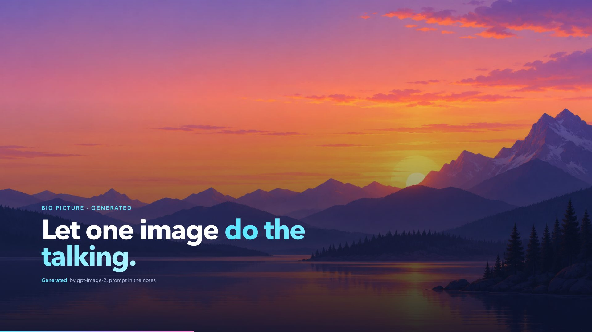

# Images for slides

Where to get images that cost nothing, how to make your own, and how to caption each so the audience knows what's real. Licence terms change: the notes below were checked against each source's own page on 21 October 2026, so re-read the licence before a commercial talk.

## Captions say where an image came from

| Caption | Use it for |
|---|---|
| `<b>Real run</b>` | A screenshot or capture of the real thing |
| `<b>Drawn</b>` | A mock-up drawn in HTML (`.mock`, `.composer`, `.cli`) or by hand |
| `<b>Sample image</b>` | A stand-in you'll replace before the talk |
| `<b>Photo</b> Name, Unsplash` | Stock or open-licence photos, with the credit the licence asks for |
| `<b>Generated</b> by gpt-image-2` | AI-generated images, naming the model |

## Quick picks

| Need | Start with | Credit |
|---|---|---|
| A photo for a full-bleed slide | [Unsplash](https://unsplash.com/license), [Pexels](https://www.pexels.com/license/) | Not required; appreciated |
| History, science, space | [NASA](https://www.nasa.gov/nasa-brand-center/images-and-media/), [Smithsonian Open Access](https://www.si.edu/openaccess) (CC0 items), [The Met](https://www.metmuseum.org/art/collection) (CC0 items), [Wikimedia Commons](https://commons.wikimedia.org) | NASA: say so; Commons: per file |
| Spot illustrations | [unDraw](https://undraw.co/license), [Open Peeps](https://www.openpeeps.com) and [Humaaans](https://www.humaaans.com) (CC0) | No |
| UI icons | [Lucide](https://lucide.dev) (ISC), [Tabler](https://tabler.io/icons) (MIT), [Phosphor](https://phosphoricons.com) (MIT), [Heroicons](https://heroicons.com) (MIT) | No |
| Brand logos | [Simple Icons](https://simpleicons.org): the SVGs are CC0, but the brands are trademarks, so follow each brand's guidelines | No, but don't imply endorsement |
| Emoji | [Noto Emoji](https://github.com/googlefonts/noto-emoji) (OFL/Apache), [Twemoji](https://github.com/jdecked/twemoji) (CC BY 4.0, credit) | Twemoji: yes |
| Diagrams | [Excalidraw](https://excalidraw.com) (MIT), [Mermaid](https://mermaid.js.org) (MIT), or HTML on the slide | No |
| Something nobody has drawn | Generate it: see below | Caption it `Generated` |

Avoid photos with recognisable people or logos unless you've cleared them. "Free to use" licences don't cover a person's likeness or a trademark. Pixabay also hosts AI-generated images; filter them out if you want real photos.

## Generate your own

A coding agent can make an illustration, background or texture with no API key and no per-image cost:

- **Codex CLI:** its built-in `image_gen` tool (gpt-image-2) runs on your Codex plan. It's good at legible text in images, UI mock-ups and photorealism. Ask Codex directly ("use your image_gen tool to make …, save it as assets/hero.png"). From another agent, delegate the request to `codex exec`.
- **Antigravity:** its `generate_image` tool (Gemini/Imagen) is good at aspect ratios, edits and keeping a character consistent. It saves JPEG.

That background came from one prompt:

> Wide landscape illustration for a presentation slide background: layered mountains at dusk, a calm lake reflecting a warm orange and violet sky, soft gradients, gentle grain, modern flat illustration style, plenty of empty sky on the left for a title. No text, no people, no logos, no watermark.

Tips:

- **Write prompts in this order:** scene, subject, details, constraints. Say what the image is for ("a slide background with empty space on the left for a title").
- **Ask for 16:9** (for example 1536×1024 or 1920×1080), or crop afterwards. Then save it as JPEG: a full-bleed photo is usually 150–300 KB as JPEG and 2 MB as PNG.
- **Keep words out of the picture.** Put titles on the slide as real text. Generated lettering can be misspelt, and slide text stays editable and readable by screen readers.
- **Put the prompt in the speaker notes,** so the image can be made again or changed.

Good uses: backgrounds, textures, spot illustrations, concept art, and mock-ups that the caption marks as mock-ups.

Don't use generated images for:

- screenshots, charts or "results" presented as real. That breaks the first rule of this template;
- real people or lookalikes;
- logos and trademarks.

YouTube requires a disclosure for realistic AI content when you upload a recorded talk ([policy](https://support.google.com/youtube/answer/14328491)); the `Generated` caption already tells the room.

## Screenshots of your own work

- **Crop before an image goes into `assets/`:** tab strips and URL bars, chat or project titles in sidebars, avatars, emails, IDs and private prices. Keep the originals outside the deck.
- **Size:** 1920 px wide is plenty for a full-width screenshot. WebP or JPEG are much smaller than PNG for screenshots with photos in them.
- **Long pages:** the `long-page` pattern scrolls them for you.
- **Captions** say what's real: `<b>Real run</b>names hidden`.

## Fonts

Decks load no web fonts from a CDN, so they work offline. To use a font from [Google Fonts](https://fonts.google.com) or [Fontsource](https://fontsource.org), which are mostly under the SIL Open Font License:

1. Download the `.woff2` files (Fontsource lists them per weight) into `templates/<name>/assets/fonts/`.
2. Add `@font-face` rules to that template's `theme.css`, and put the family first in `--sans` or `--display`, with a system fallback after it.
3. Keep the font's `OFL.txt` beside the files. The OFL lets you bundle and redistribute the font, but not sell it on its own.

## Credits

- **A licence that needs credit** (CC BY, Twemoji, Wikimedia CC BY-SA): put a short credit in the caption, such as `<b>Photo</b> Jane Doe, CC BY 4.0`, and the full credit (title, author, source, licence: "TASL") in the speaker notes or on a credits extra slide.
- **When you publish the deck:** credits in the notes ship with the HTML, so they count.
