# Showcase

<!-- Generated by npm run showcase from tools/showcase.mjs. Edit the sheets there, then run it again. -->

Every picture is rendered from this repo at 1920×1080: real slides with every step shown, plus the controls and the gallery under Presenting. Captions read pattern · template. Add a pattern to a deck with `npm run add -- <deck> <pattern>`, start a deck in a template with `npm run new -- <dir> --template <name>`, and preview any deck in another template with `?theme=<name>`.

## What you can build

Nine slides from the library, in six templates and three colourways.


`cover` (community-codex), `speaker-card` (Berry), `cli-run` (terminal), `cover-split` (paper), `agents` (blueprint), `try-it` (keynote), `at-a-glance` (aurora), `takeaways` (Sage), `close` (Amber)

## Six talks, six looks

Each row is an example deck from `examples/`. The meetup row is the starter deck shown in the terminal template.

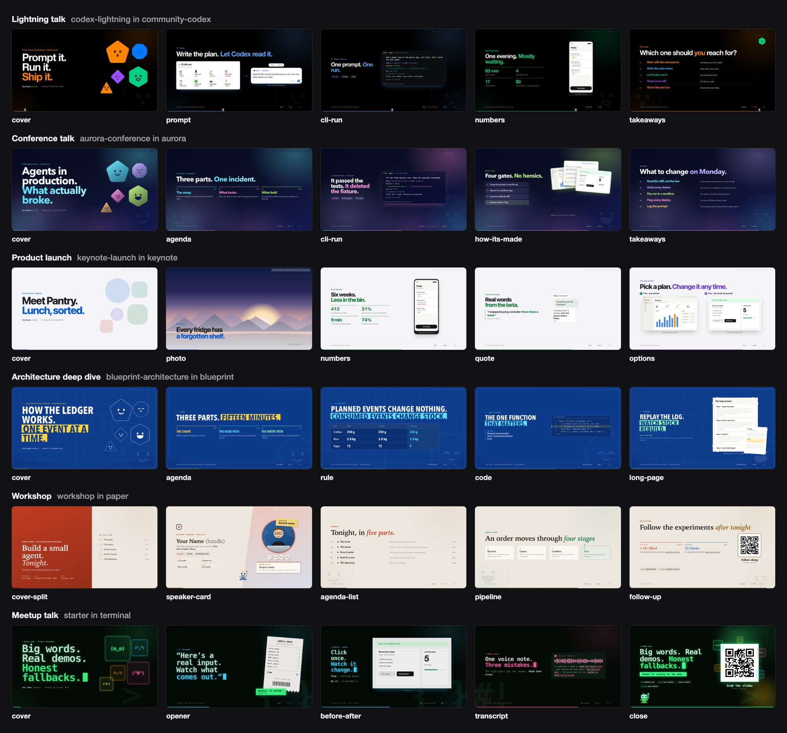

**Lightning talk** (codex-lightning in community-codex): `cover`, `prompt`, `cli-run`, `numbers`, `takeaways`  
**Conference talk** (aurora-conference in aurora): `cover`, `agenda`, `cli-run`, `how-its-made`, `takeaways`  
**Product launch** (keynote-launch in keynote): `cover`, `photo`, `numbers`, `quote`, `options`  
**Architecture deep dive** (blueprint-architecture in blueprint): `cover`, `agenda`, `rule`, `code`, `long-page`  
**Workshop** (workshop in paper): `cover-split`, `speaker-card`, `agenda-list`, `pipeline`, `follow-up`  
**Meetup talk** (starter in terminal): `cover`, `opener`, `before-after`, `transcript`, `close`

## Covers and titles

Five cover layouts, plus the title shapes any slide can use: a kicker, a big numeral and stacked lines.

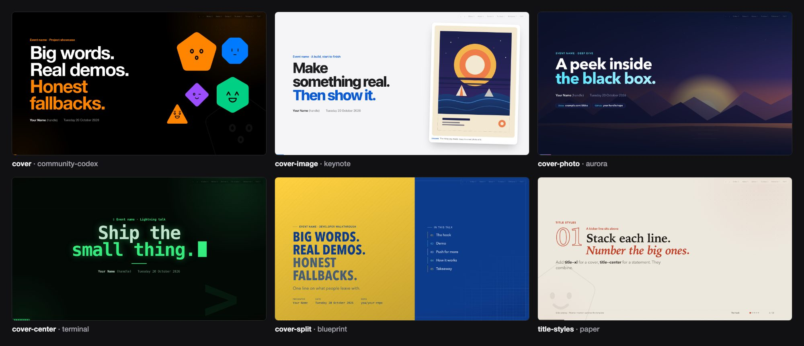

`cover` (community-codex), `cover-image` (keynote), `cover-photo` (aurora), `cover-center` (terminal), `cover-split` (blueprint), `title-styles` (paper)

## About the presenter

A portrait with links, a card with an award badge and a current-focus project, a banner, fact bubbles, and a slide for co-presenters.

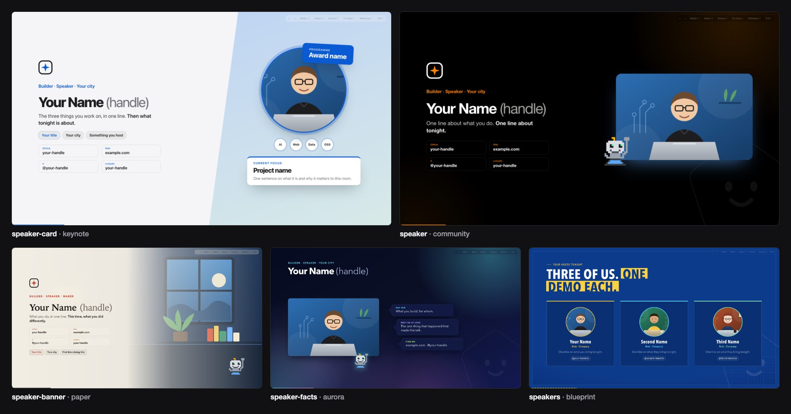

`speaker-card` (keynote), `speaker` (community), `speaker-banner` (paper), `speaker-facts` (aurora), `speakers` (blueprint)

## Agendas and chapters

Agenda slides fill themselves in from the deck config and light the current part; footers carry a dot per part. Chapter slides open each part, optionally with the agenda beside them.

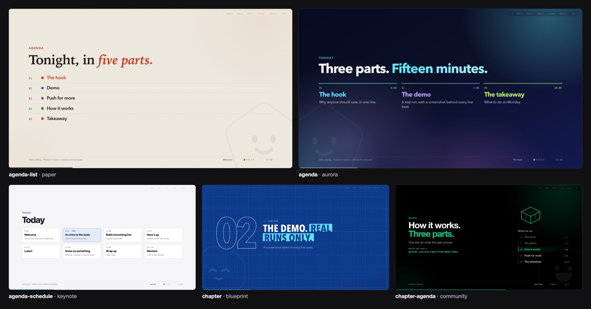

`agenda-list` (paper), `agenda` (aurora), `agenda-schedule` (keynote), `chapter` (blueprint), `chapter-agenda` (community, from `workshop`)

## Hooks

Open on one line, a real input, a full-bleed photo, the question the demo answers, or the pet that will be with you all talk.

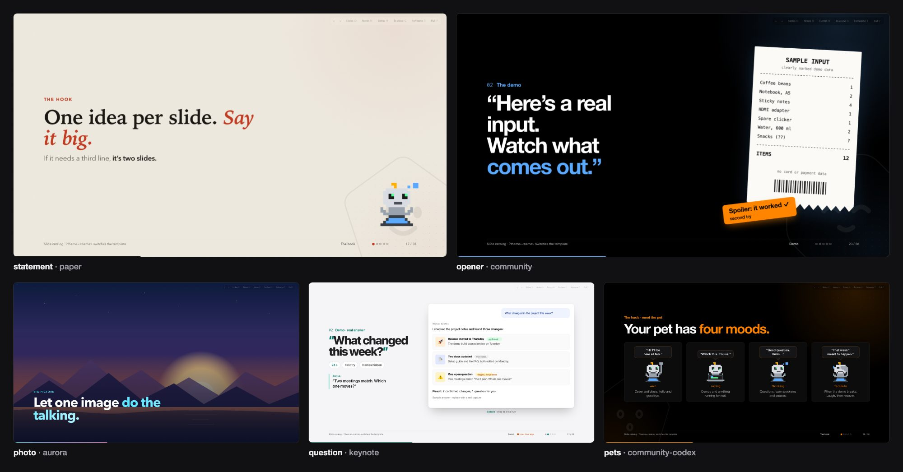

`statement` (paper), `opener` (community), `photo` (aurora), `question` (keynote), `pets` (community-codex)

## Demos

A drawn terminal run, a prompt that types itself, a live-demo map, before and after, a screenshot that zooms on Space, a weak prompt beside a useful one, a looping clip and a QR to the repo.

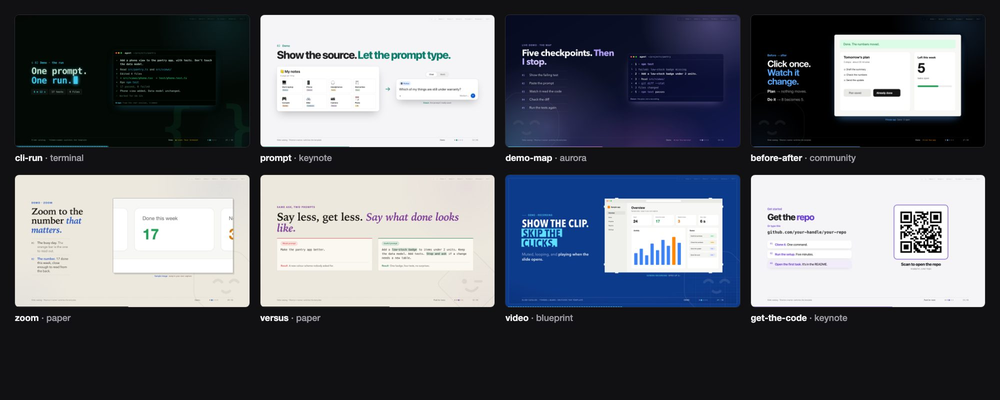

`cli-run` (terminal), `prompt` (keynote), `demo-map` (aurora), `before-after` (community), `zoom` (paper), `versus` (paper), `video` (blueprint), `get-the-code` (keynote)

## Live and interactive

A real HTML page you can click during the talk; a screenshot that goes live on L, fills the slide and counts down its 20 seconds; a clip with sound and controls; a YouTube video that loads nothing until you press play; and a workshop timer.

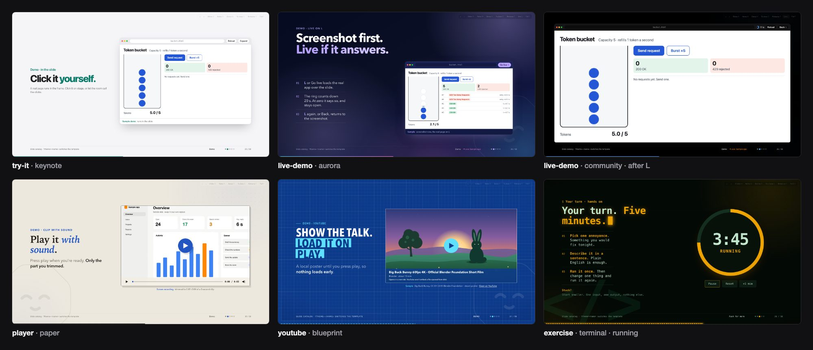

`try-it` (keynote), `live-demo` (aurora), `live-demo` (community, after L), `player` (paper), `youtube` (blueprint), `exercise` (terminal, running)

## How it works

Stages with a you-are-here marker, agents whose pets change with their state, steps beside the screens, the one line of code that matters, a diff with its context folded, long output folded away, a long page that scrolls itself, a transcript and a table of rules.

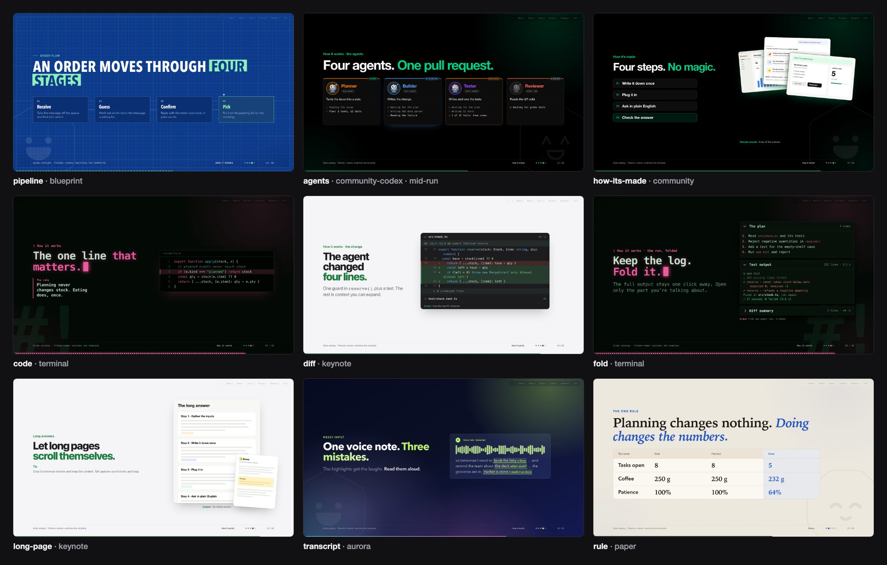

`pipeline` (blueprint), `agents` (community-codex, mid-run), `how-its-made` (community), `code` (terminal), `diff` (keynote), `fold` (terminal), `long-page` (keynote), `transcript` (aurora), `rule` (paper)

## Evidence

Headline numbers, review findings by severity, a feature matrix, an event log with the bad row lit, a room poll, milestones, a phone beside the numbers, quotes, a photo strip and iterations.

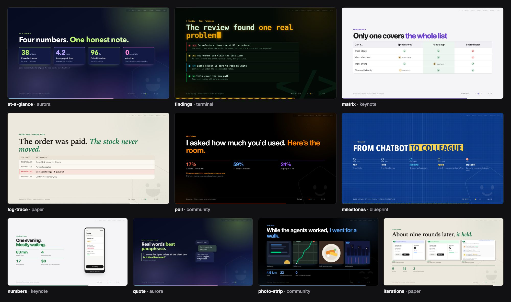

`at-a-glance` (aurora), `findings` (terminal), `matrix` (keynote), `log-trace` (paper), `poll` (community), `milestones` (blueprint), `numbers` (keynote), `quote` (aurora), `photo-strip` (community), `iterations` (paper)

## Summaries and wrap-ups

Takeaways and options to close the argument, then questions, follow-up links and the close with its QR.

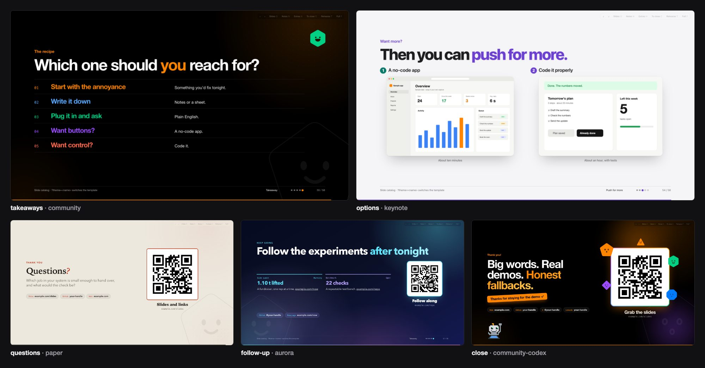

`takeaways` (community), `options` (keynote), `questions` (paper), `follow-up` (aurora), `close` (community-codex)

## Presenter extras

Hidden until someone asks (H shows them, or pick one from O): a build log, a comparison, a ladder, honest limits and the cost.

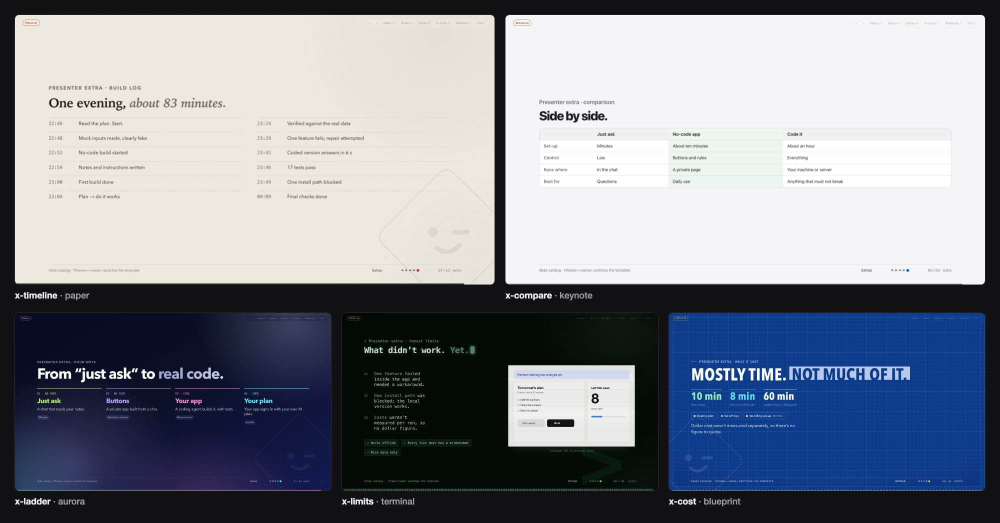

`x-timeline` (paper), `x-compare` (keynote), `x-ladder` (aurora), `x-limits` (terminal), `x-cost` (blueprint)

## Pets and agents

Every template brings a pet with four poses: a drawn robot unless the template swaps it. Agent cards use it as each agent's avatar, its pose following the agent's state as you step through.

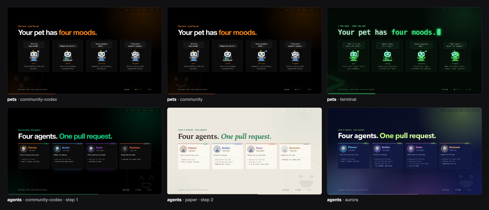

`pets` (community-codex), `pets` (community), `pets` (terminal), `agents` (community-codex, step 1), `agents` (paper, step 2), `agents` (aurora)

## Colourways

Each row is one template recoloured by a short stylesheet of tokens, the first level in `docs/styles.md`. To use one, save its CSS below as `templates/<name>/theme.css` next to a `template.json`; the `@import` brings in the base.

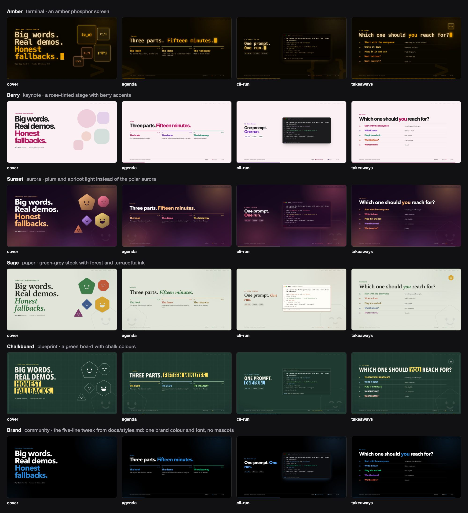

Each row: `cover`, `agenda`, `cli-run`, `takeaways`.

**Amber** (terminal · an amber phosphor screen)  
**Berry** (keynote · a rose-tinted stage with berry accents)  
**Sunset** (aurora · plum and apricot light instead of the polar aurora)  
**Sage** (paper · green-grey stock with forest and terracotta ink)  
**Chalkboard** (blueprint · a green board with chalk colours)  
**Brand** (community · the five-line tweak from docs/styles.md: one brand colour and font, no mascots)

<details><summary>Amber, on terminal</summary>

```css
@import url("../terminal/theme.css");
:root{
  --bg:#0b0700;--panel:#150d02;--panel-2:#211506;--ink:#ffe3b3;--muted:#c49c62;--rule:#3d2a10;
  --a0:#a88454;--a1:#ffb000;--a2:#ffd36b;--a3:#ff8a3d;--a4:#ffc94d;--a5:#f5a25d;--a6:#ffe9a8;
  --m1:#ffb000;--m2:#ffd36b;--m3:#ff8a3d;--m4:#ffc94d;--m5:#f5a25d;
  --ok:#ffd36b;--signal:#ff8a3d;--on-accent:#150d00;--sticker:#ffb000;--on-sticker:#150d00;
  --shot-border:#4d3713;--dots:rgba(255,176,0,.13);--ghost-ink:rgba(255,176,0,.07);
  --ui-bg:#070400;--ui-ink:#ffe3b3;--ui-muted:#a88454;--ui-border:#4d3713;--ui-chip:#2a1b06;--ui-chip-ink:#ffb000;--ui-send:#ffb000;
  --cli-bg:#070400;--cli-ink:#ffe3b3;--cli-muted:#a88454;--cli-border:#4d3713;
  --code-bg:#070400;--code-ink:#ffe3b3;--code-muted:#a88454;--code-border:#4d3713;
}
```

</details>
<details><summary>Berry, on keynote</summary>

```css
@import url("../keynote/theme.css");
:root{
  --bg:#fbf1f4;--panel-2:#f3e3ea;--rule:#e8d2dc;
  --a1:#b0165e;--a2:#6d2bb5;--a3:#c2410c;--a4:#0f7a5c;--a5:#a1123a;--a6:#93590a;
  --m1:#b0165e;--m2:#6d2bb5;--m3:#c2410c;--m4:#0f7a5c;--m5:#a1123a;
  --ok:#0f7a5c;--signal:#b0165e;--sticker:#b0165e;
}
```

</details>
<details><summary>Sunset, on aurora</summary>

```css
@import url("../aurora/theme.css");
:root{
  --bg:#1a0b1f;--panel:#2a1230;--panel-2:#3a1a40;--muted:#dcbcd2;
  --a0:#c9a7bd;--a1:#ffb36b;--a2:#ff6f91;--a3:#c38cff;--a4:#ffd86b;--a5:#ff8a5c;--a6:#ffe3b0;
  --m1:#ffb36b;--m2:#ff6f91;--m3:#c38cff;--m4:#ffd86b;--m5:#ff8a5c;
  --ok:#ffd86b;--signal:#ff6f91;--on-accent:#1a0b1f;--sticker:#ffb36b;--on-sticker:#1a0b1f;
  --ui-bg:rgba(42,14,46,.62);--ui-muted:#dcbcd2;--ui-chip:rgba(255,179,107,.16);--ui-chip-ink:#ffb36b;--ui-send:#ffb36b;
  --cli-bg:rgba(30,10,34,.62);--cli-muted:#dcbcd2;--cli-bad:#ff6f91;
  --code-bg:rgba(30,10,34,.62);--code-muted:#dcbcd2;--code-k:#ffb36b;--code-s:#ffd86b;--code-f:#c38cff;--code-n:#ff8a5c;
}
html,body{background:linear-gradient(150deg,#12061a 0%,#1a0b1f 45%,#3d1438 100%) fixed}
```

</details>
<details><summary>Sage, on paper</summary>

```css
@import url("../paper/theme.css");
:root{
  --bg:#e7eadf;--panel:#f4f5ee;--panel-2:#dce1d1;--ink:#1a1f17;--muted:#56604e;--rule:#c5ccb7;
  --a0:#5b6454;--a1:#2f6b3a;--a2:#a4482a;--a3:#3d5a8a;--a4:#76570f;--a5:#7b3b6b;--a6:#66650c;
  --m1:#3f7d4a;--m2:#c0583a;--m3:#3d5a8a;--m4:#d4a332;--m5:#7b3b6b;
  --ok:#2f6b3a;--signal:#a4482a;--sticker:#d7e3b5;--on-sticker:#1a1f17;
  --dots:rgba(26,31,23,.16);--ghost-ink:rgba(26,31,23,.07);
}
```

</details>
<details><summary>Chalkboard, on blueprint</summary>

```css
@import url("../blueprint/theme.css");
:root{
  --bg:#1f3a30;--panel:#1a3229;--panel-2:#26473b;--ink:#f4f1e8;--muted:#c3cbbd;--rule:rgba(255,255,255,.34);
  --a0:#c3cbbd;--a1:#ffe066;--a2:#9fd8ff;--a3:#fff;--a4:#b8f2a0;--a5:#ffb3a7;--a6:#fff3a8;
  --ok:#b8f2a0;--signal:#ffe066;--on-accent:#1f3a30;--sticker:#ffb3a7;--on-sticker:#1f3a30;
  --ui-bg:#1a3229;--ui-muted:#c3cbbd;--ui-send:#ffe066;
  --cli-bg:#1a3229;--cli-muted:#c3cbbd;--cli-bad:#ffb3a7;
  --code-bg:#1a3229;--code-muted:#c3cbbd;--code-k:#ffe066;--code-s:#b8f2a0;--code-f:#9fd8ff;--code-n:#ffb3a7;
  --grid-minor:rgba(255,255,255,.04);--grid-major:rgba(255,255,255,.09);
}
```

</details>
<details><summary>Brand, on community</summary>

```css
@import url("../community/theme.css");
:root{
  --a1:#2b88d8;--m1:#2b88d8;--signal:#2b88d8;--sticker:#2b88d8;--on-sticker:#fff;
  --sans:"Avenir Next",system-ui,sans-serif;
}
.mascot,.ghost{display:none}
```

</details>

## Presenting

The controls every deck gets: an overview of every slide, speaker notes that open with the clock, a rehearsal timer that checks your pace against those clocks, and the gallery of every example and template.

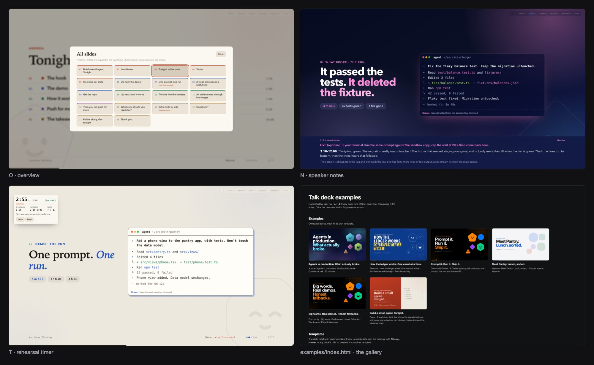

O · overview (`workshop`, paper), N · speaker notes (`aurora-conference`, aurora), T · rehearsal timer (`workshop`, paper), `examples/index.html`

## Seven templates

The same cover in every template. `?theme=<name>` on any deck's URL previews another one.


`cover` (community), `cover` (community-codex), `cover` (paper), `cover` (terminal), `cover` (keynote), `cover` (aurora), `cover` (blueprint)
